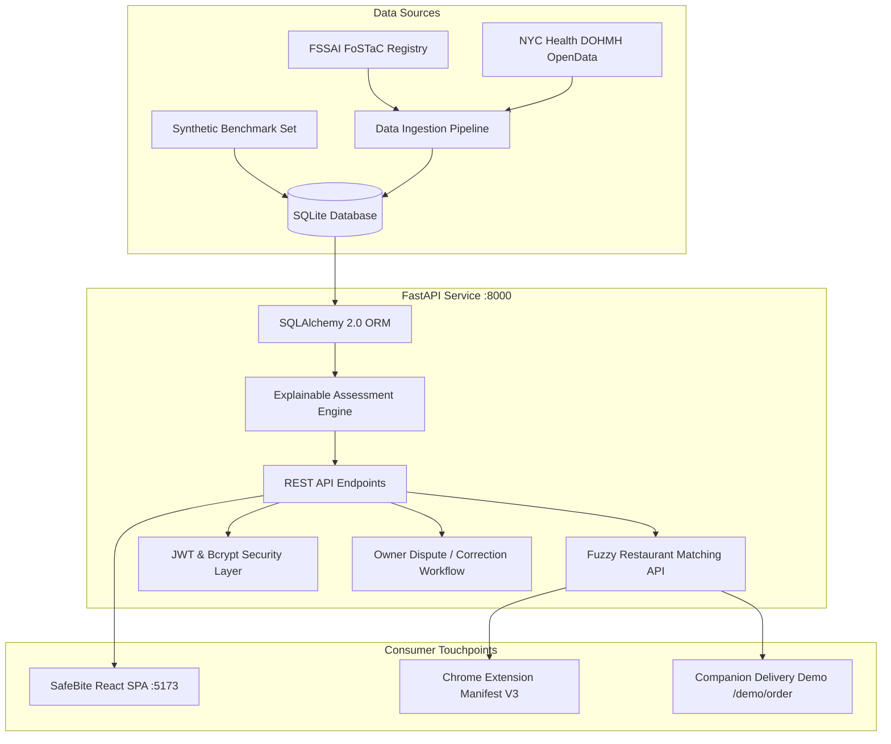

# SafeBite — Food Safety Transparency Platform

[](https://fastapi.tiangolo.com)
[](https://reactjs.org/)
[](https://vitejs.dev/)
[](https://docs.pytest.org/)
[](docs/MUTATION_TEST_REPORT.json)
[](extension/)
[](docs/project-evidence/SafeBite_Project_Evidence.pdf)

> **SafeBite** is an enterprise-grade food safety intelligence and transparency platform engineered to bridge information asymmetry between municipal health inspection registries (such as FSSAI FoSTaC in India and NYC DOHMH in the US) and consumers ordering food online.

---

## 📑 Quick Navigation & Documentation Index

All 14 required system documents are organized in [`docs/`](docs/) and linked below:

| Document | Description |
|---|---|
| [**Consolidated Evidence Dossier (PDF)**](docs/project-evidence/SafeBite_Project_Evidence.pdf) | **11-Page PDF** containing complete project proof, genuine UI screenshots, test runs, and audit logs |
| [**Implementation Audit**](docs/IMPLEMENTATION_AUDIT.md) | Exhaustive baseline audit, resolved defects, and architectural refactoring |
| [**Feature Status Matrix**](docs/FEATURE_STATUS.md) | Granular matrix of fully implemented, demonstrable, and bounded features |
| [**Technical Decisions**](docs/TECHNICAL_DECISIONS.md) | Architecture rationale: scoring engine, data provenance, auth, and extension |
| [**Data Sources**](docs/DATA_SOURCES.md) | Verified official data registry specifications (FSSAI FoSTaC & NYC DOHMH) |
| [**Data Import Guide**](docs/DATA_IMPORT_GUIDE.md) | Ingestion CLI pipeline, JSON schema validation, and rejected-record handling |
| [**Browser Extension**](docs/BROWSER_EXTENSION.md) | Manifest V3 Chrome Extension architecture, DOM matching, and injected UI |
| [**Testing Strategy**](docs/TESTING_STRATEGY.md) | Quality assurance methodology: Unit, Integration, Regression, and Mutation testing |
| [**Test Cases Specification**](docs/TEST_CASES.md) | Granular test catalog with IDs, inputs, expected vs actual outputs |
| [**Test Execution Results**](docs/TEST_RESULTS.md) | 23/23 Pytest logs, 100% mutation kill report, and test run evidence |
| [**Version Control**](docs/VERSION_CONTROL.md) | Git branching strategy, commit conventions, rollback protocols, and `.gitignore` |
| [**Build and Run Guide**](docs/BUILD_AND_RUN.md) | Step-by-step local setup, Docker Compose instructions, and health checks |
| [**Demonstration Guide**](docs/DEMO_GUIDE.md) | Evaluator click-through walkthrough (Customer, Owner, Admin, Extension) |
| [**Tools and Technologies**](docs/TOOLS_AND_TECHNOLOGIES.md) | Comprehensive inventory of libraries, versions, credentials, and local execution |

---

## 🏛️ System Architecture



---

## 🌟 Core Innovations & Highlights

1. **Traceable Data Provenance**:
   - Every record carries rigorous provenance metadata (`source_name`, `source_url`, `source_record_id`, `verification_status`, `confidence_score`, `is_synthetic`, `data_freshness_status`).
   - Official records (FSSAI / NYC) and synthetic benchmark records are strictly isolated. Synthetic records prominently carry disclaimers to prevent misleading consumers.
2. **Deterministic, Explainable Assessment Engine**:
   - Dynamic safety score (0–100) calculated from infraction severity, escalating repeat violations ($1.5\times$ penalty multiplier), inspection recency, verified complaints, and license suspension overrides.
   - Provides consumer grade labels (`Excellent`, `Good`, `Needs Improvement`, `High Risk`), positive compliance factors, and risk deductions with consumer safety advisories.
3. **Google Chrome Manifest V3 Extension**:
   - Offline-capable service worker (`background.js`) and content script (`content.js`). Scrapes restaurant names from delivery order pages and displays real-time floating safety score pills.
4. **Companion Food Ordering Demonstration**:
   - Interactive delivery ordering simulation (`/demo/order`) providing a simulated Swiggy/Zomato style food menu, cart management, and real-time SafeBite audit popups.
5. **Owner Dispute & Administrative Governance**:
   - Restaurant owners can submit official evidence and dispute records (`POST /api/restaurants/{id}/correction-request`).
   - Administrators review, approve, or reject correction requests via the dedicated tab on the Admin Dashboard (`/admin/dashboard`).

---

## ⚡ Quick Start (Local Run)

### Prerequisites
- Python 3.10+ (tested on Python 3.12.4)
- Node.js 18+ (tested on Node 20.x)
- Google Chrome (optional, for extension demonstration)

### 1. Backend Setup
```bash
cd backend
python -m venv venv
# Windows:
.\venv\Scripts\activate
# Linux/macOS:
source venv/bin/activate

pip install -r requirements.txt reportlab selenium
python migrate_db.py
python ingest_inspection_data.py
python -m uvicorn app.main:app --host 127.0.0.1 --port 8000 --reload
```
*Backend health check:* `curl http://127.0.0.1:8000/api/health`

### 2. Frontend Setup
```bash
cd frontend
npm install
npm run dev
```
*Frontend runs at:* `http://127.0.0.1:5173/`

### 3. Demo Credentials
| Role | Email | Password | Access |
|---|---|---|---|
| **Administrator** | `admin@safebite.demo` | `adminpassword` | Full moderation, approval, correction review |
| **Customer** | `customer@safebite.demo` | `password123` | Directory browsing, inspection audit, demo order |
| **Restaurant Owner** | `owner@safebite.demo` | `password123` | Listing management, dispute submission |

---

## 🐳 Docker Container Orchestration

Run both backend and frontend simultaneously with Docker Compose:
```bash
docker-compose up --build
```
- Frontend: `http://localhost:3000`
- Backend API: `http://localhost:8000`
- Health check: `http://localhost:8000/api/health`

---

## 🧪 Testing & Verification

Execute the complete test suite:
```bash
cd backend
# 1. Automated Integration, Unit, and Regression Tests (23 Tests)
pytest -v

# 2. Mutation Testing (Assessment Engine Fault Injection)
python tests/run_mutation_testing.py
```
- **Pytest**: 23 passed in ~17s (100% pass rate)
- **Mutation Testing**: 7 mutants generated, 7 killed (100% mutation score)

---

## 🧩 Chrome Browser Extension Setup

1. Open Google Chrome and navigate to `chrome://extensions/`.
2. Toggle on **Developer mode** in the top-right corner.
3. Click **Load unpacked**.
4. Select the `extension/` directory from this repository.
5. Navigate to `http://127.0.0.1:5173/demo/order` to see the live SafeBite safety pill injected into the host page!