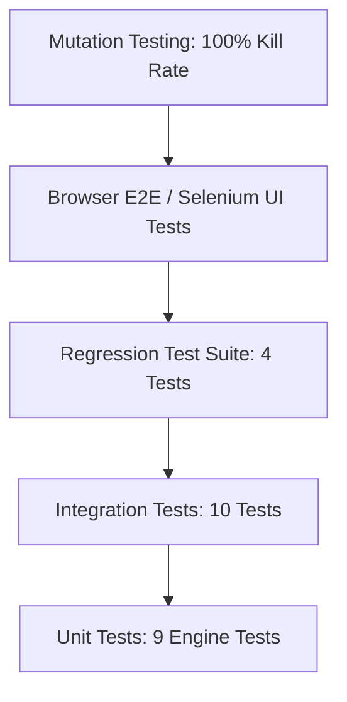

# SafeBite — Quality Assurance & Testing Strategy

**Version:** 1.0.0  
**Test Lead:** QA & Systems Engineering Team  

---

## 1. Quality Assurance Philosophy

Food safety ratings directly influence consumer dining choices and restaurant reputations. An inaccurate deduction or an undetected scoring bug could unjustly harm a business or misinform a diner about a severe health risk. Consequently, SafeBite mandates a multi-layered, zero-compromise testing strategy:



---

## 2. Test Classification & Coverage

### 2.1 Unit Testing: Assessment Engine Rules
- **Target:** `backend/app/core/assessment.py`
- **Location:** `backend/tests/test_assessment.py`
- **Philosophy:** Test scoring edge cases in isolation without requiring database I/O.
- **Coverage Areas:**
  - Base score initialization (100 points for flawless inspections).
  - Critical vs non-critical violation point deductions.
  - Repeat violation escalation ($1.5\times$ penalty multiplier).
  - Stale inspection degradation ($>365$ days old).
  - Suspended license automatic override to High Risk ($\le 35$).
  - Uninspected restaurant fallback handling.
  - Verified customer complaint deductions.

### 2.2 Integration Testing: API, DB, and Matching
- **Target:** FastAPI endpoints, SQLAlchemy relational persistence, fuzzy search.
- **Location:** `backend/test_api.py`, `backend/tests/test_extension_and_matching.py`, `backend/tests/test_provenance.py`, `backend/tests/test_disputes_and_admin.py`
- **Coverage Areas:**
  - JWT Authentication workflows (registration, login, profile token resolution).
  - Restaurant matching endpoint (`/api/restaurants/match`) via exact, fuzzy, and cross-city queries.
  - Data provenance attribute verification on REST payloads.
  - Owner data correction submission and administrative review/approval cycle.

### 2.3 Regression Testing: Defect Prevention
- **Target:** Known resolved baseline defects from the initial audit.
- **Location:** `backend/tests/test_regression.py`
- **Coverage Areas:**
  - `REG-001`: Admin login verification (guaranteeing no bcrypt hash KeyError).
  - `REG-002`: Customer login verification with seeded demo credentials.
  - `REG-003`: Database URL validation ensuring no hardcoded `d:/` drive dependencies.
  - `REG-004`: `GET /api/profile` alias route persistence for session validation.

### 2.4 Mutation Testing: Test Suite Robustness
- **Target:** Fault injection in scoring algorithms.
- **Runner:** `backend/tests/run_mutation_testing.py`
- **Methodology:** Introduces deliberate syntax/semantic mutations into `assessment.py` (e.g. flipping penalty signs, modifying multipliers, disabling staleness checks) and verifies that test assertions catch and "kill" every mutant.
- **Goal:** 100% Mutation Score (achieved: 7/7 mutants killed).

### 2.5 End-to-End & Browser Automation
- **Target:** Full-stack DOM rendering, client interactions, responsive layouts.
- **Runner:** `backend/capture_all_evidence.py` via headless Selenium Chrome.
- **Coverage Areas:**
  - Navigation across homepage, restaurant directory, and detail pages.
  - Provenance filter selection and live DOM card updating.
  - Companion food ordering demo (/demo/order) cart updates and modal inspection.
  - Mobile viewport responsiveness (390x844 iPhone dimensions).

---

## 3. Test Execution Commands

```bash
# Run all automated unit, integration, and regression tests
cd backend
pytest -v

# Run mutation testing suite
python tests/run_mutation_testing.py

# Run browser automation & evidence screenshot capture
python capture_all_evidence.py
```
